--------------
Appendix A
--------------

.. _app-diagrams-label:

Diagrams
-----------

The sector diagrams in English:

   1. :ref:`Redevelop --> Environ. Damage <sect-diag-1-label>`.
   2. :ref:`Redevelop --> Redevelop <sect-diag-2-label>`.
   3. :ref:`Production --> Production <sect-diag-3-label>`.
   4. :ref:`Production --> Environ. Damage <sect-diag-4-label>`.
   5. :ref:`Environ. Damage --> Environ. Damage <sect-diag-5-label>`.
   6. :ref:`Environ. Damage --> Quality of Life <sect-diag-6-label>`.
   7. :ref:`Education --> Education <sect-diag-7-label>`.
   8. :ref:`Education --> Quality of Life <sect-diag-8-label>`.
   9. :ref:`Education --> Reproduction Rate <sect-diag-9-label>`.
   10. :ref:`Quality of Life --> Quality of Life <sect-diag-10-label>`.
   11. :ref:`Quality of Life --> Reproduction Rate <sect-diag-11-label>`.
   12. :ref:`Quality of Life --> Politics <sect-diag-12-label>`.
   13. :ref:`Reproduction Rate --> Population <sect-diag-13-label>`.
   14. :ref:`Population --> Quality of Life <sect-diag-14-label>`.
   15. :ref:`Population --> Action Points <sect-diag-15-label>`.
   16. :ref:`Politics --> Action Points <sect-diag-16-label>`.
   17. :ref:`Production --> Action Points <sect-diag-17-label>`.
   18. :ref:`Quality of Life --> Action Points <sect-diag-18-label>`.
   19. :ref:`Production --> V (factor for A) <sect-diag-19-label>`.
   20. :ref:`Population --> W (factor for box 13) <sect-diag-20-label>`.

.. _sect-diag-1-label:

Diagram 1
===========

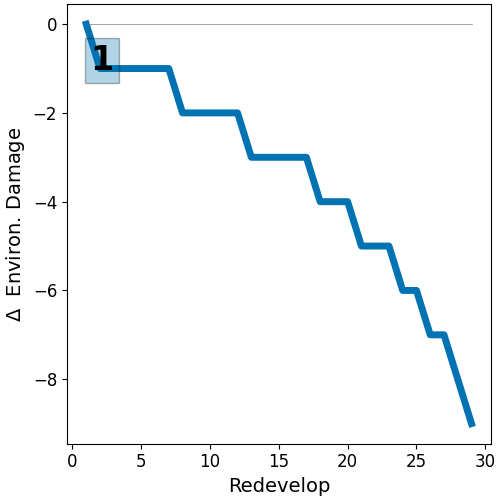

.. _sect-diag-2-label:

Diagram 2
===========

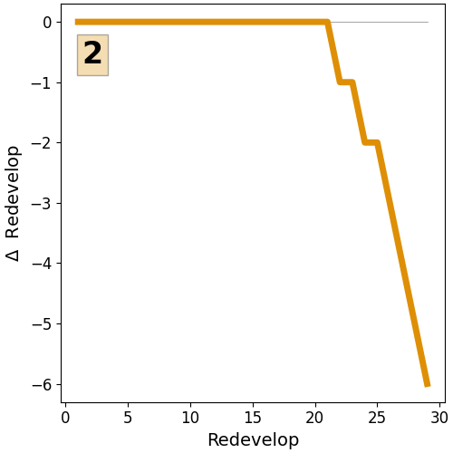

.. _sect-diag-3-label:

Diagram 3
===========

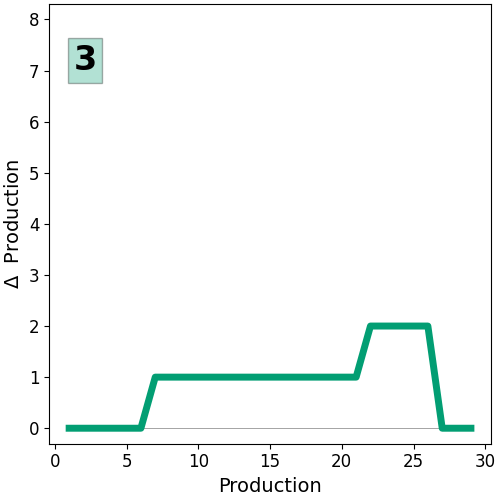

.. _sect-diag-4-label:

Diagram 4
===========

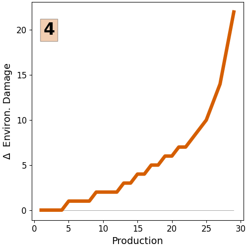

.. _sect-diag-5-label:

Diagram 5
===========

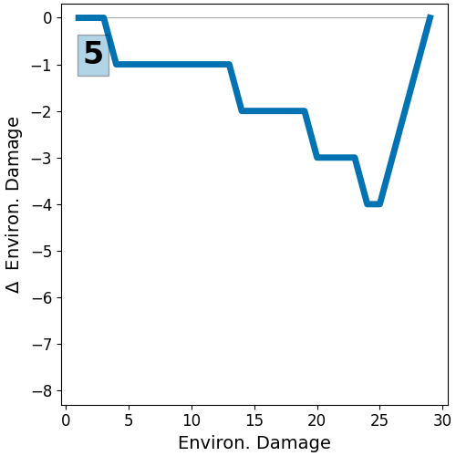

.. _sect-diag-6-label:

Diagram 6
===========

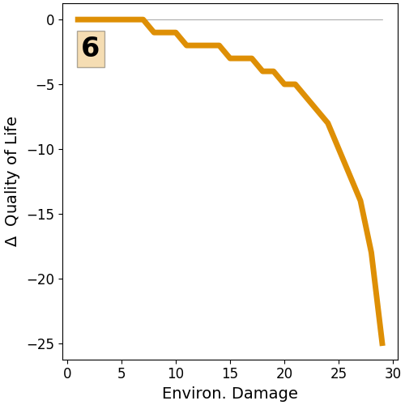

.. _sect-diag-7-label:

Diagram 7
===========

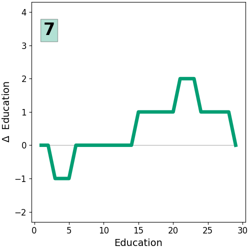

.. _sect-diag-8-label:

Diagram 8
===========

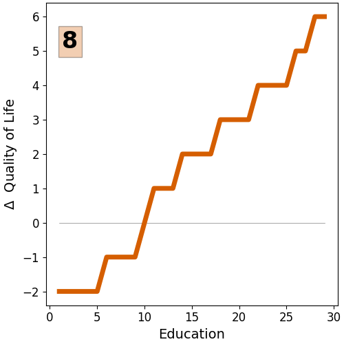

.. _sect-diag-9-label:

Diagram 9
===========

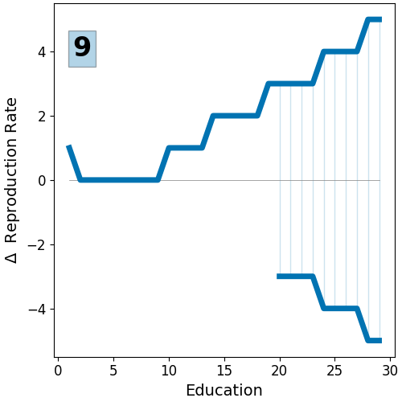

.. _sect-diag-10-label:

Diagram 10
===========

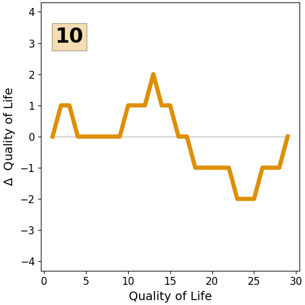

.. _sect-diag-11-label:

Diagram 11
===========

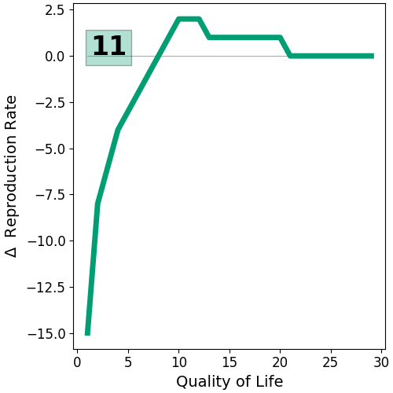

.. _sect-diag-12-label:

Diagram 12
===========

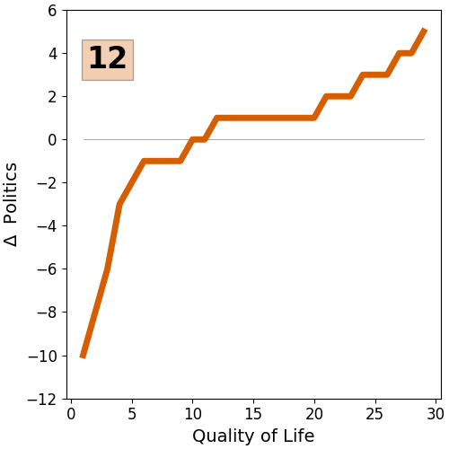

.. _sect-diag-13-label:

Diagram 13
===========

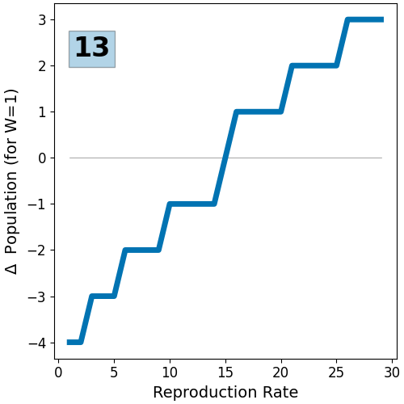

.. _sect-diag-14-label:

Diagram 14
===========

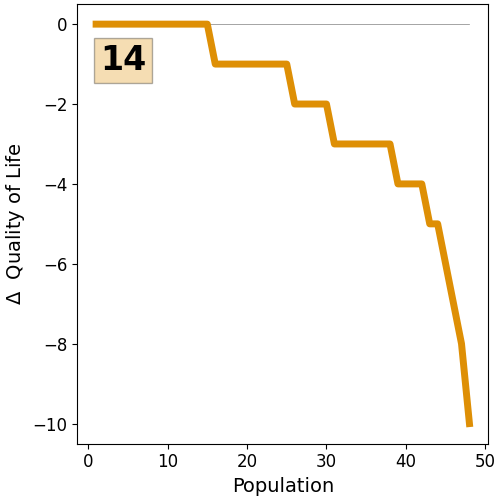

.. _sect-diag-15-label:

Diagram 15
===========

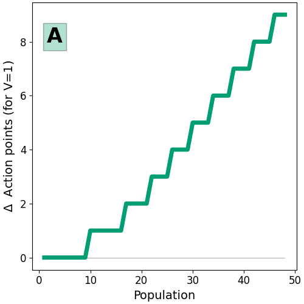

.. _sect-diag-16-label:

Diagram 16
===========

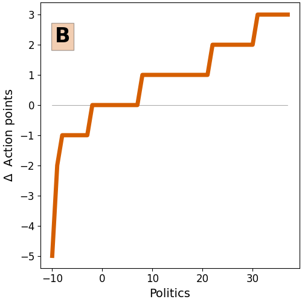

.. _sect-diag-17-label:

Diagram 17
===========

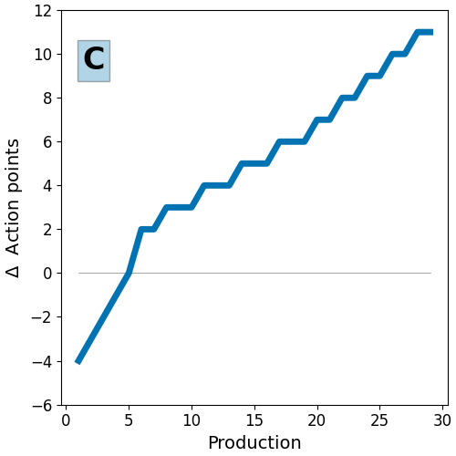

.. _sect-diag-18-label:

Diagram 18
===========

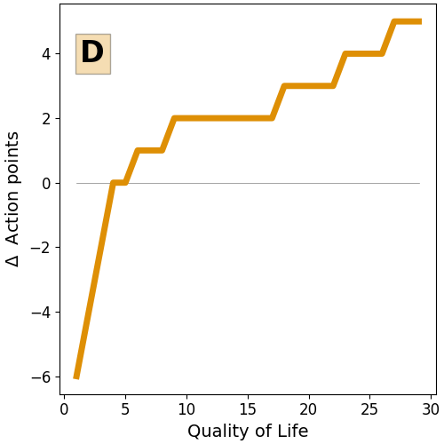

.. _sect-diag-19-label:

Diagram 19
===========

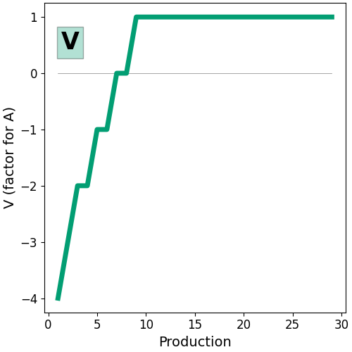

.. _sect-diag-20-label:

Diagram 20
===========

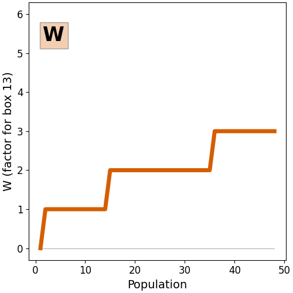

.. csv-table:: **All The Diagrams 01 - 06 (click on image to enlarge)**
   :header: "No", "Diagram", No ,"Diagram"

   1, |diag01.png|, 2, |diag02.png|
   3, |diag03.png|, 4, |diag04.png|
   5, |diag05.png|, 6, |diag06.png|
