--------------
Appendix B
--------------

.. _de-app-diagrams-label:

Diagramme
-----------

Die Sektor-Diagramme auf Deutsch:

   1. :ref:`Sanierung --> Umweltbelastung <dsect-diag-1-label>`.
   2. :ref:`Sanierung --> Sanierung <dsect-diag-2-label>`.
   3. :ref:`Produktion --> Produktion <dsect-diag-3-label>`.
   4. :ref:`Produktion --> Umweltbelastung <dsect-diag-4-label>`.
   5. :ref:`Umweltbelastung --> Umweltbelastung <dsect-diag-5-label>`.
   6. :ref:`Umweltbelastung --> Lebensqualität <dsect-diag-6-label>`.
   7. :ref:`Aufklärung --> Aufklärung <dsect-diag-7-label>`.
   8. :ref:`Aufklärung --> Lebensqualität <dsect-diag-8-label>`.
   9. :ref:`Aufklärung --> Vermehrungsrate <dsect-diag-9-label>`.
   10. :ref:`Lebensqualität --> Lebensqualität <dsect-diag-10-label>`.
   11. :ref:`Lebensqualität --> Vermehrungsrate <dsect-diag-11-label>`.
   12. :ref:`Lebensqualität --> Politik <dsect-diag-12-label>`.
   13. :ref:`Vermehrungsrate --> Bevölkerung <dsect-diag-13-label>`.
   14. :ref:`Bevölkerung --> Lebensqualität <dsect-diag-14-label>`.
   15. :ref:`Bevölkerung --> Aktionspunkte <dsect-diag-15-label>`.
   16. :ref:`Politik --> Aktionspunkte <dsect-diag-16-label>`.
   17. :ref:`Produktion --> Aktionspunkte <dsect-diag-17-label>`.
   18. :ref:`Lebensqualität --> Aktionspunkte <dsect-diag-18-label>`.
   19. :ref:`Produktion --> V (Faktor für A) <dsect-diag-19-label>`.
   20. :ref:`Bevölkerung --> W (Faktor für Box 13) <dsect-diag-20-label>`.

.. _dsect-diag-1-label:

Diagramm 1
===========

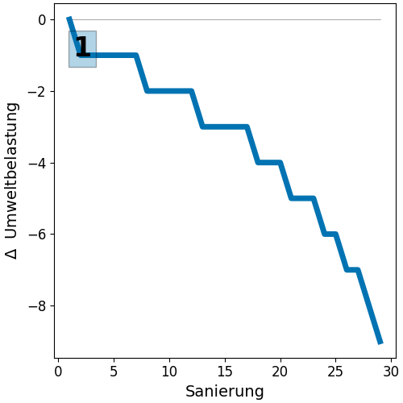

.. _dsect-diag-2-label:

Diagramm 2
===========

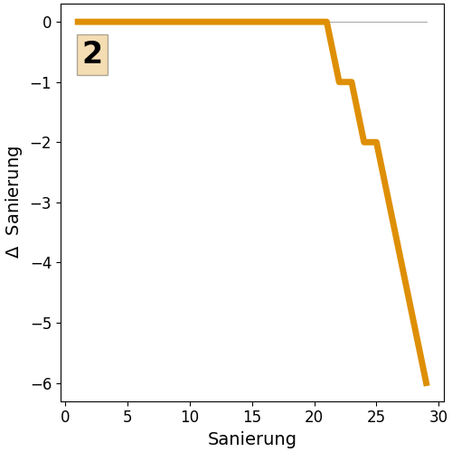

.. _dsect-diag-3-label:

Diagramm 3
===========

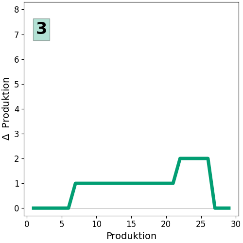

.. _dsect-diag-4-label:

Diagramm 4
===========

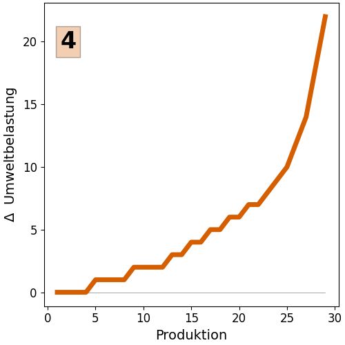

.. _dsect-diag-5-label:

Diagramm 5
===========

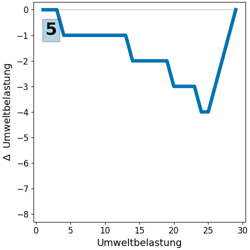

.. _dsect-diag-6-label:

Diagramm 6
===========

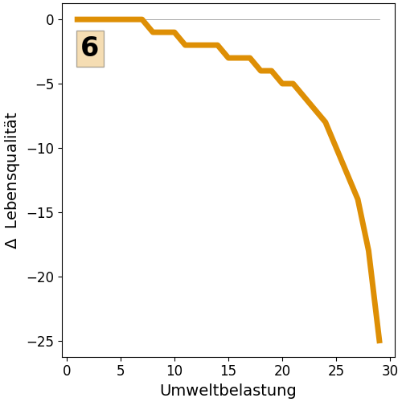

.. _dsect-diag-7-label:

Diagramm 7
===========

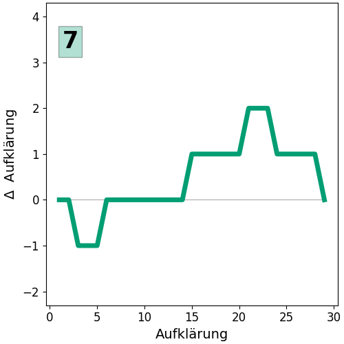

.. _dsect-diag-8-label:

Diagramm 8
===========

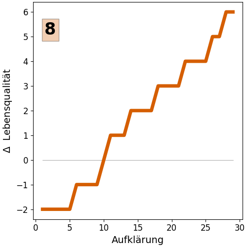

.. _dsect-diag-9-label:

Diagramm 9
===========

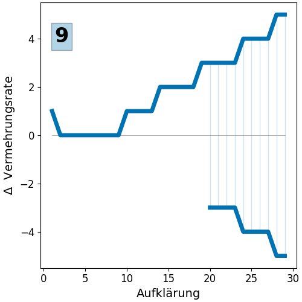

.. _dsect-diag-10-label:

Diagramm 10
===========

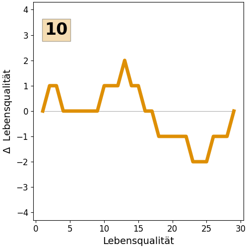

.. _dsect-diag-11-label:

Diagramm 11
===========

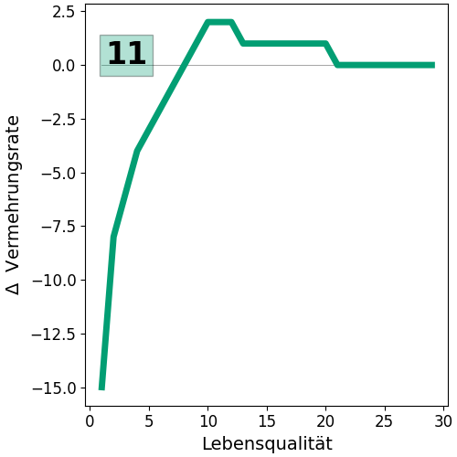

.. _dsect-diag-12-label:

Diagramm 12
===========

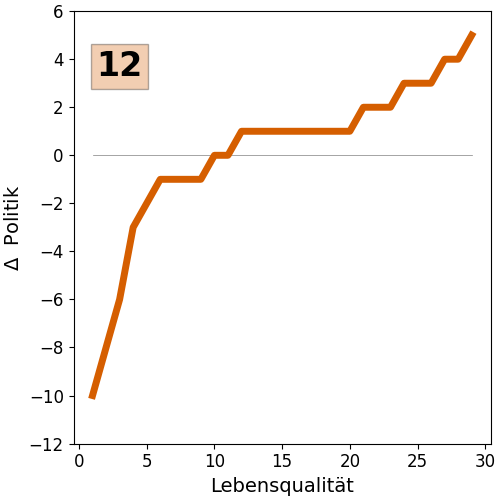

.. _dsect-diag-13-label:

Diagramm 13
===========

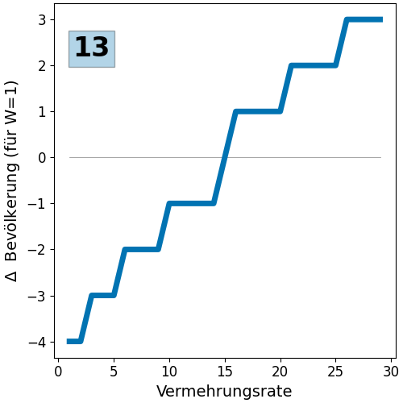

.. _dsect-diag-14-label:

Diagramm 14
===========

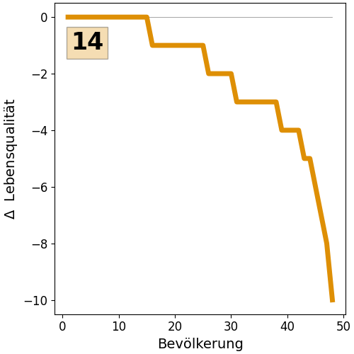

.. _dsect-diag-15-label:

Diagramm 15
===========

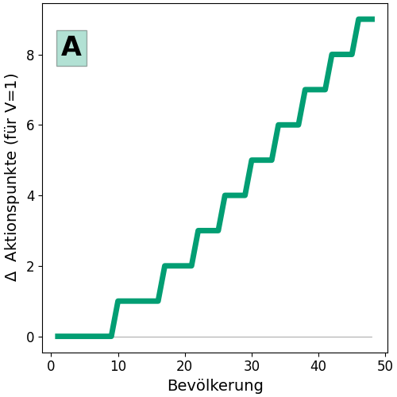

.. _dsect-diag-16-label:

Diagramm 16
===========

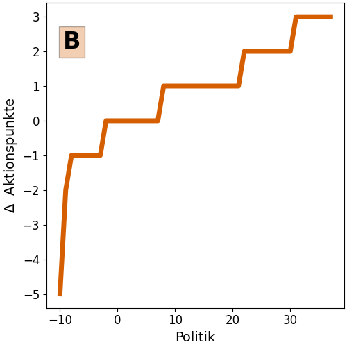

.. _dsect-diag-17-label:

Diagramm 17
===========

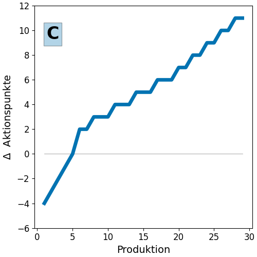

.. _dsect-diag-18-label:

Diagramm 18
===========

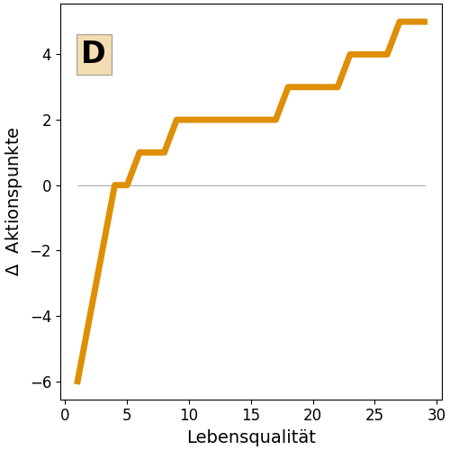

.. _dsect-diag-19-label:

Diagramm 19
===========

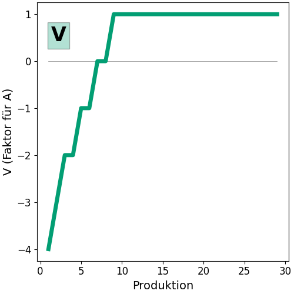

.. _dsect-diag-20-label:

Diagramm 20
===========

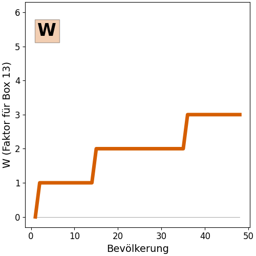

.. csv-table:: **Alle Diegramme 01 - 06 (zum Vergrößern klicken)**
   :header: "Nr", "Diagramm", Nr ,"Diagramm"

   1, |diag01.png|, 2, |diag02.png|
   3, |diag03.png|, 4, |diag04.png|
   5, |diag05.png|, 6, |diag06.png|
