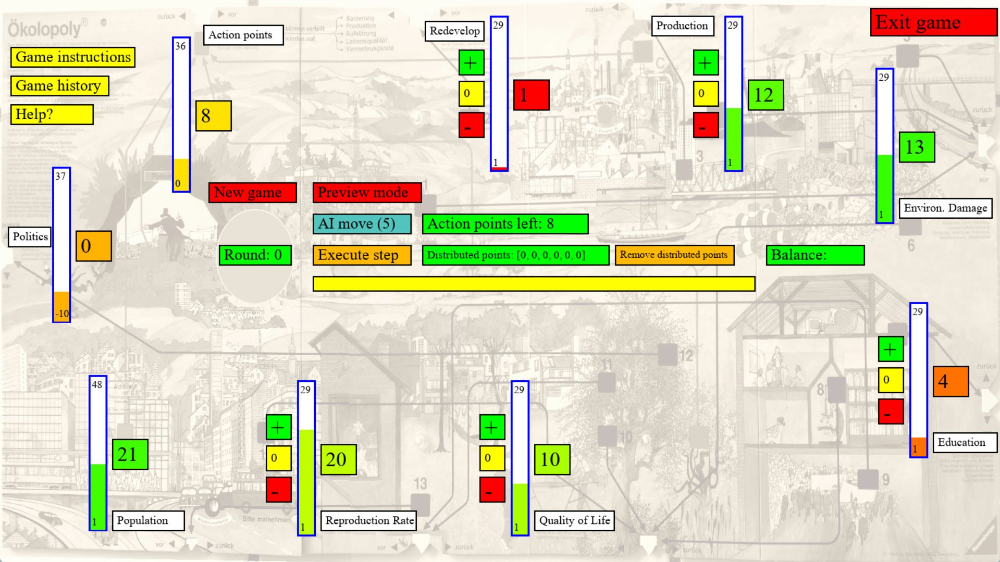

--------
Overview
--------

What is **oekolopoly_v2** and what is contained in this documentation?

oekolopoly_v2
----------------

**oekolopoly_v2** is available from `<https://github.com/WolfgangKonen/oekolopoly_v2>`_.

This package allows to train deep reinforcement learning agents (DRL) from `Stable Baselines 3 (SB3) <https://stable-baselines3.readthedocs.io/en/master/>`_ on the game
*Ökolopoly*. *Ökolopoly* is a game with a very large action space and which is not easy to master for humans due to its
mutual nonlinear interdependencies.

The trained agents can be evaluated or used to play an episode on the console.

The trained agents are also useful to support humans in the task of learning to master the game:

    - First, there is the so called **AI Move** in ``oekolopoly_gui.py`` which provides hints for the human by letting the AI
      (a trained agent) suggest the next move.
    - Second, humans can get support from the so-called **Preview mode**: This mode provides what-if scenarios:
      What if I distribute the action points as indicated, what would be the cumulated sector changes if I execute
      this move?
    - Third, if the what-if-move would lead to a 'Game Over' situation, then the **Preview mode console** warns
      and gives the reason, which sector would trigger the 'Game Over' condition.

These supportive features are part of ``oekolopoly_gui.py``, a GUI that allows to play the game
Ökolopoly interactively:

Documentation
-----------------

This documentation contains:

    - a brief introduction to the game Ökolopoly
    - how to install oekolopoly_v2, how to train DRL agents, evaluate and play with them the game Ökolopoly
    - more details on the game mechanics
    - more details on the available wrappers

Publications
-------------
You can read more about DRL and Ökolopoly in the following scientific publications:

- [Engelh23]_

Authors and Credits
-------------------

The **oekolopoly_v2** environment was developed by

- Ralitsa Raycheva, TH Köln
- Alexander Albers, TH Köln
- Raphael Engelhardt, TH Köln
- Wolfgang Konen, TH Köln

The **oekolopoly_v2** realization relies on these other Python packages and software tools:

- ``stable-baselines3`` and ``sb3-contrib`` for the Deep RL agents
- ``gymnasium`` for interfacing the game with the Deep RL agents
- ``pygame`` for the game GUI
- ``Sphinx`` for building the package documentation from inline docstrings and .rst files
- ``readthedocs.io`` for deploying and hosting the documentation pages
- and more other standard Python packages

We acknowledge and are grateful for all the work that goes into these great open source software tools!

.. [Engelh23] Engelhardt, Raphael C.; Raycheva, Ralitsa; Lange, Moritz; Wiskott, Laurenz; Konen, Wolfgang. **Ökolopoly: Case Study on Large Action Spaces in Reinforcement Learning.** In: Nicosia, G.; Pardalos, P.; others, (eds.): 9th International Conference **LOD 2023**, Springer Nature, 2023. (https://www.gm.fh-koeln.de/ciopwebpub/Engelh23a.d/Engelh23a.pdf)

