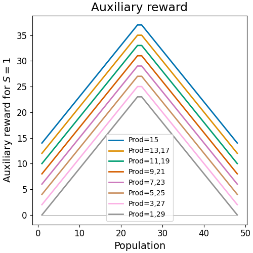
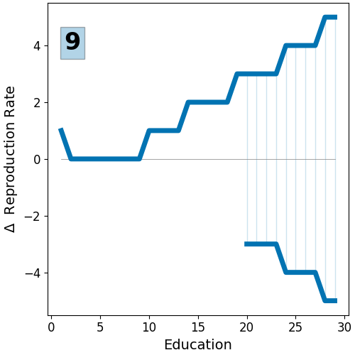
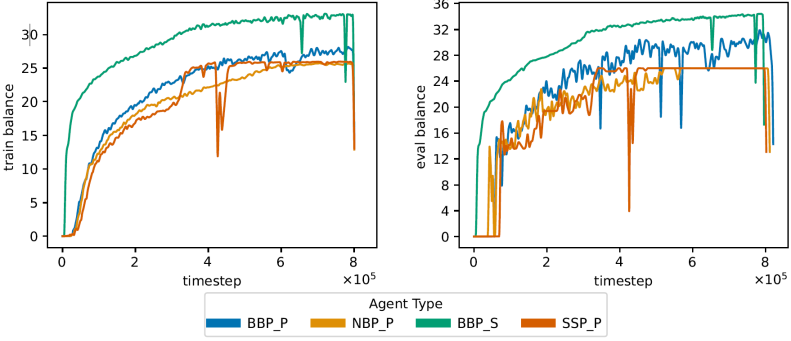
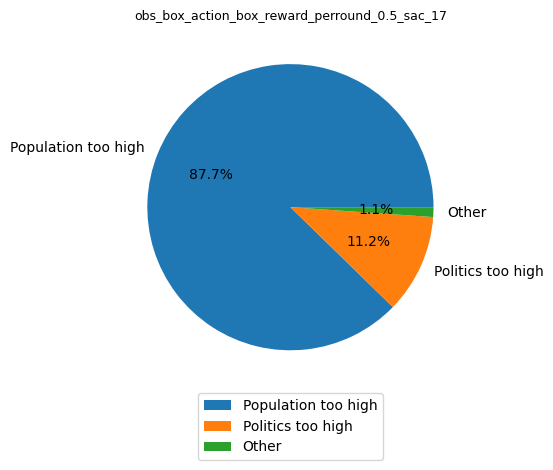

--------------
Plot Utilities
--------------

This chapter describes the plot utilites in ``oekolopoly_v2``.

Aux Diagram
----------------

.. autofunction:: plot_aux_diag.plot_aux_diag_png

Sector Diags
----------------

.. autoclass:: plot_sector_diag.SectorPlotter
   :members: __init__, plot_1_sector_diag_png, plot_4_sector_diag_pdf

Training Curves
----------------

.. autofunction:: plot_feature.plot_feature_curves

.. _agent-code-label:

.. autofunction:: plot_feature.agent_code

Pie Charts
----------------

.. autofunction:: plot_piecharts.plot_all_piecharts

