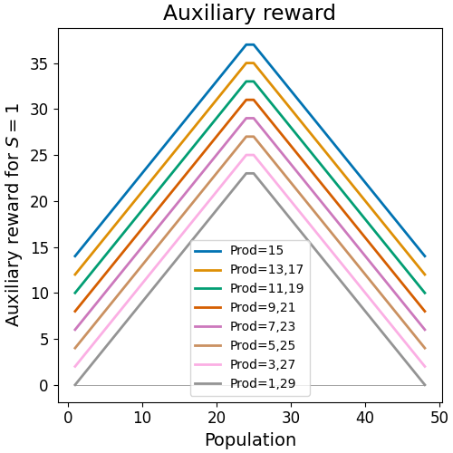

.. _wrapper-label:

--------------
Wrappers
--------------

This chapter describes the wrappers in ``oekolopoly_v2``.

.. _act-wrapper-label:

Action Wrappers
----------------
In the absence of any action wrapper (``--action "none"``), the environment :class:`.OekoEnv` receives in each
:meth:`step` an action vector from a 5-dimensional ``MultiDiscrete`` action space that specifies the action points
assigned to the 5 actionable (steerable) :ref:`sectors <sector-label>` in this round.

Action wrappers in general (see `gymnasium.../action_wrappers <https://gymnasium.farama.org/api/wrappers/action_wrappers>`_
or search in `gym/core.py <https://github.com/openai/gym/blob/master/gym/core.py>`_ for ``ActionWrapper``)
wrap an environment and let :meth:`step` operate with a modified action. Classes derived from
``ActionWrapper`` are forced to implement the method :meth:`action`.

.. autoclass:: oekolopoly.wrappers.OekoBoxActionWrapper
   :members: __init__

.. autoclass:: oekolopoly.wrappers.OekoBoxUnclippedActionWrapper
   :members: __init__

.. autoclass:: oekolopoly.wrappers.OekoSimpleActionWrapper
   :members: __init__

.. _obs-wrapper-label:

Observation Wrappers
--------------------
In the absence of any observation wrapper (``--observation "none"``), the environment :class:`.OekoEnv` handles the
observation space as 10-dimensional ``MultiDiscrete`` space (9 = number of :ref:`sectors <sector-label>`, steerable or
not) plus 1 dimension for the observable ``round`` which has min 0 and max 30.
Given the min and max of each :ref:`sector <sector-label>`, this amounts to :math:`1.48\cdot 10^{14}` states.

Observation wrappers in general (see `gymnasium.../observation_wrappers <https://gymnasium.farama.org/api/wrappers/observation_wrappers>`_
or search in `gym/core.py <https://github.com/openai/gym/blob/master/gym/core.py>`_ for
``ObservationWrapper``) wrap an environment and let :meth:`step` and :meth:`reset` return a modified observation. Classes derived from
``ObservationWrapper`` are forced to implement the method :meth:`observation`.

.. autoclass:: oekolopoly.wrappers.OekoBoxObservationWrapper
   :members: __init__

.. autoclass:: oekolopoly.wrappers.OekoSimpleObservationWrapper
   :members: __init__

.. _rew-wrapper-label:

Reward Wrappers
----------------

In the absence of any reward wrapper (``--reward "none"``), the environment :class:`.OekoEnv` just
returns a reward on episode termination, all other steps have reward 0. The reward on episode
termination is the game balance :math:`B` according to the :ref:`balance formula <balance-label>`.

Reward wrappers in general (see `gymnasium.../reward_wrappers <https://gymnasium.farama.org/api/wrappers/reward_wrappers>`_
or search in `gym/core.py <https://github.com/openai/gym/blob/master/gym/core.py>`_ for
``RewardWrapper``) wrap an environment and let :meth:`step` return a modified reward. Classes derived from
``RewardWrapper`` are forced to implement the method :meth:`reward`.

.. autoclass:: oekolopoly.wrappers.OekoAuxRewardWrapper
   :members: __init__

.. _diag-aux-reward-label:

.. autoclass:: oekolopoly.wrappers.OekoPerRoundRewardWrapper
   :members: __init__

